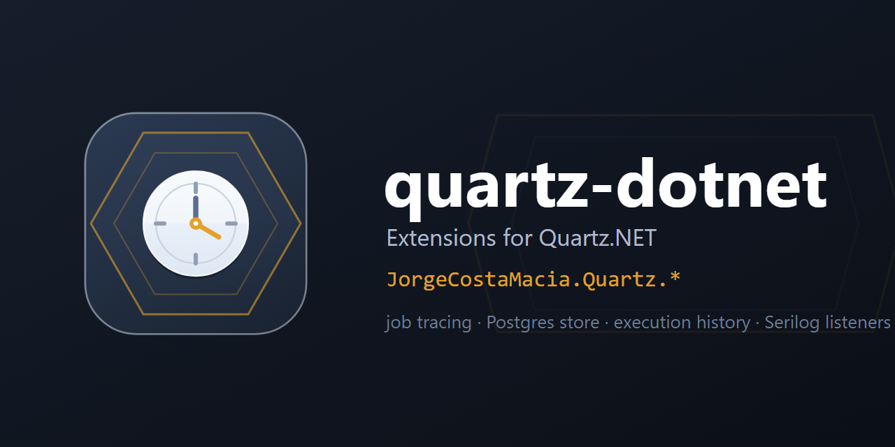

  

# quartz-dotnet

> Extensions for [Quartz.NET](https://www.quartz-scheduler.net/) — job-execution trace correlation, the clustered Postgres store with its execution history and hosted-scheduler defaults, and Serilog job and trigger listeners — each scoped to a single concern and shipped independently under `JorgeCostaMacia.Quartz.*`.

Part of the `JorgeCostaMacia.*` family, alongside [ddd-dotnet](https://github.com/JorgeCostaMacia/ddd-dotnet) (DDD building blocks), [serilog-dotnet](https://github.com/JorgeCostaMacia/serilog-dotnet) (the Serilog baseline), [bus-net](https://github.com/JorgeCostaMacia/bus-net) (messaging) and [http-net](https://github.com/JorgeCostaMacia/http-net) (ASP.NET Core). Moved out of [shared-net](https://github.com/JorgeCostaMacia/shared-net) in 10.2.0, with the same package ids.

An independent project: it builds on Quartz.NET through its own extension points (extension methods on the builders and options Quartz hands the host, and its listener interfaces) and is not affiliated with the Quartz.NET project.

## Requirements

The **.NET 10** SDK.

## Packages

| Package | What it does |
| --- | --- |
| [JorgeCostaMacia.Quartz](https://www.nuget.org/packages/JorgeCostaMacia.Quartz/) | `JobTrace` — idempotent AggregateId/CorrelationId correlation on the Quartz execution context — plus `WithPostgresDefaults()`, the clustered Postgres store every host repeats, and `WithDefaults()` for its execution history and its hosted scheduler. |
| [JorgeCostaMacia.Quartz.Serilog](https://www.nuget.org/packages/JorgeCostaMacia.Quartz.Serilog/) | Quartz job/trigger log listeners — fixed low-cardinality messages, everything variable in the log context. |

## Contact

- [LinkedIn](https://www.linkedin.com/in/jorge-costa-macia-842817164/)
- [GitHub](https://github.com/JorgeCostaMacia/)
- [Bitbucket](https://bitbucket.org/jorgecostamacia/)
